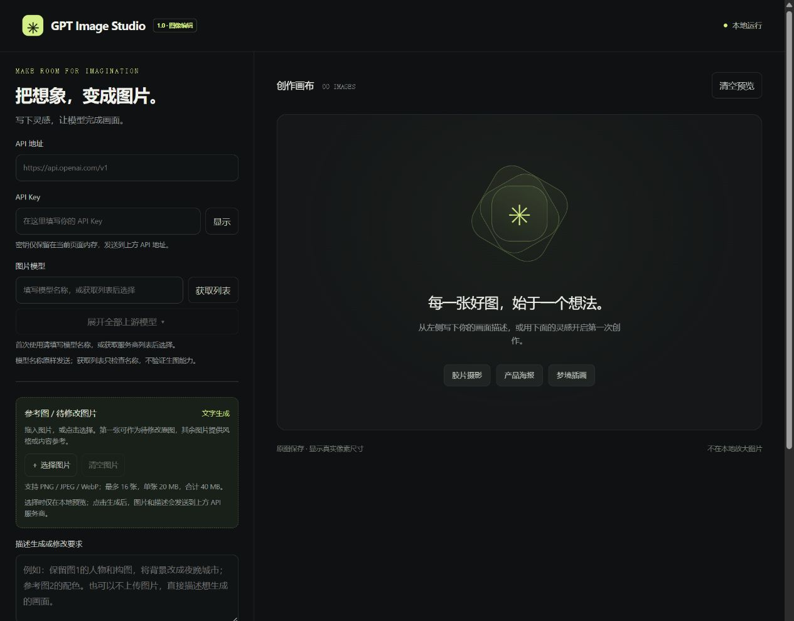

# GPT Image Studio

本地运行的中文 AI 图片生成与编辑工具。填写自己的 OpenAI 或兼容接口地址、API Key 和模型，即可文生图、上传参考图、修改图片，并请求最高 4K UHD 分辨率。

Python 3.10+ · 运行时零第三方依赖 · Windows / macOS / Linux · MIT



## 功能

- 文生图、单图修改、多图参考创作；支持选择文件和拖拽上传。
- 将生成结果用作下一轮参考图，继续修改。
- 4K UHD 横图 `3840×2160`、竖图 `2160×3840`、自定义宽高。
- `low / medium / high / xhigh / max / auto` 画质；可选 `complexity` 规划强度。
- PNG / JPEG / WebP 输出，自动保存原图并显示真实像素尺寸。
- 获取服务商模型列表、本地参数检查、HTTP 错误与请求参数排查。
- API Key 不写入应用配置、浏览器存储或应用日志。

具体模型、参数、4K 和编辑接口的可用性取决于 API 服务商及账号权限。软件本身免费，API 调用可能收费。

## 快速开始

1. 安装 [Python 3.10 或更新版本](https://www.python.org/downloads/)。Windows 安装时勾选 **Add Python to PATH**。
2. 下载仓库 ZIP 并完整解压，或克隆仓库。
3. Windows 双击 `start.bat`；macOS / Linux 在项目目录运行 `bash start.sh`。
4. 在自动打开的浏览器中填写 **API 根地址、API Key、模型名称**。
5. 输入描述，按需上传参考图，点击生成。

也可以直接启动，无需安装 pip 包：

```bash
python app.py
```

macOS / Linux 如果没有 `python` 命令，请使用 `python3 app.py`。

保持启动窗口打开，关闭窗口或按 `Ctrl+C` 停止服务。浏览器未打开时，复制终端输出的完整本地链接（包括 `#` 后的会话标识）。

### 接口配置

| 字段 | 填写方式 |
| --- | --- |
| API 地址 | 例如 `https://api.openai.com/v1`，或服务商提供的兼容 API 根地址 |
| API Key | 对应服务商的密钥，仅在当前会话使用 |
| 模型 | 服务商实际支持的模型 ID；可以手动填写或获取列表 |

API 地址和模型首次使用时均留空，地址示例仅作提示。模型可手动填写或从服务商列表中选择；列表始终显示获取到的全部模型，不会按输入框中已有的名称过滤。不要把完整的 `/images/generations` 或 `/images/edits` 路径填入地址栏。自定义模型名原样发送，不会自动替换别名。

文生图使用 `POST /images/generations`；上传参考图后使用 `POST /images/edits`，以 multipart/form-data 传输。程序不要求安装 OpenAI SDK。支持 `data[].b64_json` 和 `data[].url` 图片响应。

### 图片参考与修改

点击“＋ 选择图片”或拖入图片，按预览编号在描述中引用：

> 保留图1的人物和构图，将背景换成海边日落；参考图2的配色，其余细节尽量保持不变。

最多 16 张，支持 PNG / JPEG / WebP；本工具限制单张 20 MB、合计 40 MB、每张不超过 16,777,216 像素。选图时只在本地预览，点击生成后才发送给 API 服务商。生成结果的“用作参考 / 继续修改”会将结果追加到参考图列表；只修改新结果时请先移除旧参考图。

### 4K 与画质

点击“设为 4K 横图”，即可设置 `3840×2160`、1 张和 600 秒超时。画质与规划强度是独立选项；“最高画质”并不等于 4K。程序按原始字节保存结果，不在本地放大图片。

尺寸规则、模型兼容范围和排错步骤见 [使用指南](docs/usage.md)。

## 数据与本地运行

- 生成图片保存到 `generated/`，该目录被 Git 和发布打包脚本排除。
- 本程序不保存 API Key、输入提示词或原始参考图；生成的结果文件会留在本地。
- 浏览器保存 API 地址、模型和选项；这些设置属于当前本地端口的站点存储。默认随机端口，固定端口可复用非敏感设置。
- 服务仅监听 `127.0.0.1`，会话标识每次启动更新。此项目用于个人本机使用，没有多用户认证或公网部署支持。
- 点击生成会向选定服务商发送密钥、提示词和参考图；服务商的数据处理方式由其政策决定。

可选命令：

```bash
python app.py --no-browser
python app.py --port 7860
python app.py --version
```

这是带 Python 后端的本地应用，**不能直接作为 GitHub Pages 静态网站运行**。上传 GitHub 用于分发源码，下载后在本机启动。

## 开发与测试

运行应用不需要安装依赖。只有开发测试需要 Pillow，用来构造测试图片：

```bash
python -m pip install -r requirements-dev.txt
python -m unittest discover -s tests -v
```

测试使用本地模拟服务，不需要 API Key，不调用付费 API。覆盖文生图、multipart 编辑、多图顺序、4K 原图保存、尺寸校验、访问校验、错误处理等。GitHub Actions 配置为在 Windows / Ubuntu 的 Python 3.10 / 3.13 上执行测试，并检查前端 JavaScript 语法。

生成可分发压缩包：

```bash
python scripts/package_release.py
```

发布包位于 `dist/`。脚本只打包明确列出的项目文件，不会扫描和收集用户生成的图片、缓存或密钥文件。

## 项目结构

```text
app.py                  本地 HTTP 服务与 API 请求
web/                    网页界面、交互和上传预览
tests/                  本地模拟接口测试
scripts/                发布打包脚本
docs/                   使用、GitHub 上传说明和预览
.github/workflows/       自动测试
start.bat / start.sh     启动脚本
```

[上传到 GitHub 的步骤](docs/github-upload.md) · [参与开发](CONTRIBUTING.md) · [更新记录](CHANGELOG.md)

## 许可证

[MIT License](LICENSE)。本项目是独立客户端，与 OpenAI 或任何 API 服务商没有隶属关系。
